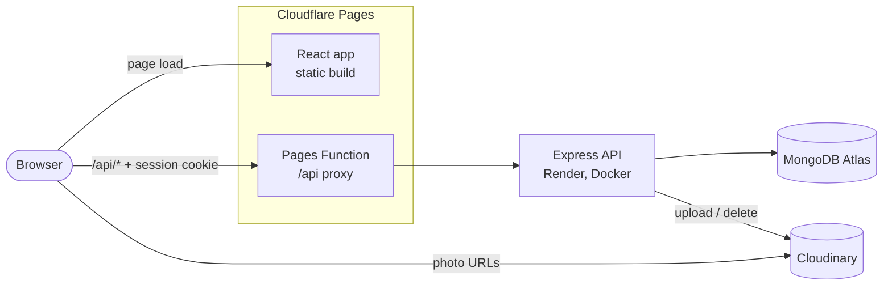

# Pet Adoption System

[](https://github.com/BojanSovtic/pet-adoption-system/actions/workflows/ci.yml)

**Live demo:** [pet-adoption-26o.pages.dev](https://pet-adoption-26o.pages.dev) · **Source:** [github.com/BojanSovtic/pet-adoption-system](https://github.com/BojanSovtic/pet-adoption-system)

A full-stack web application where people list pets that need a new home, other people apply to adopt them, and the person who listed the pet reviews the applications and accepts one.

It is a portfolio and learning project built with React, Express and MongoDB in a TypeScript Nx monorepo. The focus is on doing the fundamentals properly: server-side authorization, consistent state changes under concurrency, safe file uploads, automated tests at several levels and a working deployment.

> The live demo runs on free hosting tiers. Anyone can register an account to try it. Please don't enter real personal data.

## Contents

- [Features](#features)
- [Technical highlights](#technical-highlights)
- [Tech stack](#tech-stack)
- [Architecture](#architecture)
- [Running locally](#running-locally)
- [Testing](#testing)
- [Deployment](#deployment)
- [Documentation](#documentation)
- [Scope and limitations](#scope-and-limitations)

## Features

### Browsing (no account needed)

- Paginated pet list with name search, species and status filters, and sorting by newest, oldest, name or age. The search state lives in the URL, so the Back button and shared links keep it.
- Pet pages with a photo gallery and profile facts: species, age, sex, breed, how the pet gets along with children, dogs and cats, and how long it can be left alone.
- English and Serbian interface, switchable from the header.

### Accounts

- Registration and sign-in with email and password. Sessions last 7 days.
- An account menu with My pets, Add a pet, Applications, Messages and My profile.
- Public member profiles (visible to signed-in users) that show only the name, join date and currently listed pets.

### Listing pets

- Any signed-in user can list a pet and becomes its owner. Only the owner can edit or delete it.
- Up to 5 photos per pet (JPEG, PNG or WebP). The owner chooses which one is the main photo.
- A **My pets** page with every pet the user owns and its adoption status.

### Adoption applications

- Signed-in users apply for another person's pet with a short message and can withdraw a pending application.
- Owners see each applicant's name, email and message, and accept or reject the application.
- Accepting one application marks the pet as adopted and automatically rejects the other pending applications.
- Pet status (available → pending → adopted) follows the applications automatically and can't be set by hand.

### Messaging

- Text conversations between a pet's owner and an interested user, one per pet and person, visible only to the two participants.

### Administration

- An admin area for users with the `admin` role: platform statistics and lists of all users, pets and applications.
- Admins can grant or remove the admin role, suspend and reinstate accounts, and hide or restore listings. Applications are read-only for admins, and adoption decisions stay with the pet's owner.
- Every admin change, refused change attempt and view of personal data is recorded in a hash-chained audit log, which `pnpm audit:verify` checks for tampering.
- The first admin is created from the command line. Registration never assigns a role.

All rules, including rate limits and edge cases, are in [docs/requirements.md](docs/requirements.md).

## Technical highlights

- **Consistent adoption decisions.** Submitting, accepting, rejecting and withdrawing each run in a MongoDB transaction that locks the pet first, with unique indexes as the final guarantee. Concurrency tests check that two simultaneous acceptances can't both succeed.
- **Shared state machines.** Application and pet statuses change only through explicit actions (`accept`, `reject`, `withdraw`) that are defined once in a shared TypeScript library. The API uses them to enforce the rules, and the UI uses them to decide which actions to show.
- **Authorization on the server.** Owner and applicant ids always come from the session, never from the request body. Role and suspension are read from the database on every request.
- **Session security.** Server-side sessions with an HttpOnly cookie, Argon2id password hashing, a new session id on sign-in, and `SameSite=Lax` cookies combined with an `Origin` check against CSRF.
- **Abuse limits.** Rate limits on sign-in and registration, per-user limits on every write, per-admin limits and a per-IP limit on all writes.
- **Safe photo uploads.** Files are checked by their content, not their name, and then decoded and re-encoded with sharp. This strips EXIF/GPS metadata, applies rotation and enforces pixel and size limits. The original uploaded bytes are never stored.
- **A single error contract.** The API returns stable error codes (`{ code, details? }`) and no display text. The web app translates the codes, including field-level validation errors.
- **Isolated tests.** API tests run against an in-memory MongoDB replica set, so transactions are real and no database setup is needed. Playwright tests start their own servers and use a throwaway database.

## Tech stack

| Area                 | Technologies                                                                                                          |
| -------------------- | --------------------------------------------------------------------------------------------------------------------- |
| Frontend             | React 19, TypeScript, Vite, React Router 6, TanStack Query, Axios, Tailwind CSS 4 with shadcn/ui, react-i18next, zod  |
| Backend              | Node.js 22, Express 4, express-session with connect-mongo, Argon2, multer with sharp, express-rate-limit, helmet, zod |
| Database and storage | MongoDB 8 (replica set, for transactions) with Mongoose 9; pet photos on local disk or in Cloudinary                  |
| Shared code          | `@pet-adoption/models`: API types, constants and state machines, with no runtime dependencies                         |
| Testing              | Vitest, Testing Library, Supertest, mongodb-memory-server, Playwright                                                 |
| Tooling              | Nx 23 monorepo, pnpm workspaces, esbuild (API bundle), ESLint, Prettier, Docker and Docker Compose, GitHub Actions    |
| Hosting (live demo)  | Cloudflare Pages (web app and an `/api` proxy Function), Render (API Docker image), MongoDB Atlas, Cloudinary         |

## Architecture

```text
apps/api                 Express API (@pet-adoption/api)
apps/web                 React single-page app (@pet-adoption/web)
apps/web-e2e             Playwright end-to-end tests (@pet-adoption/web-e2e)
packages/shared/models   Types and rules shared by the API and the web app (@pet-adoption/models)
functions/api            Cloudflare Pages Function that forwards /api requests to the API
docs/                    Project documentation
```

- **Web app.** A Vite-built React SPA organized into feature folders (`pets`, `applications`, `messages`, `users`, `auth`, `admin`). It talks to the API over JSON with Axios. The base URL comes from `VITE_API_URL`, and the session cookie is sent with each request. TanStack Query handles caching, retries and error handling.
- **API.** An Express app with routes, controllers, services and Mongoose models per feature. It validates every request with zod, authenticates and authorizes it, applies rate limits, runs adoption changes in transactions, and processes and stores photos. Errors go through one error handler that returns the shared error format.
- **Database.** MongoDB stores users, sessions, pets, applications, conversations, messages and the admin audit log. It must run as a replica set because adoption decisions use transactions.
- **Photo storage.** Photos go through a small `FileStorage` interface. Local development and Docker QA store them on disk. The live demo stores them in Cloudinary, because the API host has no persistent disk. MongoDB keeps only the storage keys.

In the live demo, the browser loads the app from Cloudflare Pages and sends API requests to the same origin. A Pages Function forwards them to the API on Render, and the API refuses requests that don't come through the proxy. Keeping a single origin lets the `SameSite=Lax` session cookie work without cross-site cookies.



Detailed diagrams of the request pipeline, authentication, roles, data model, adoption workflow and test environments are in [docs/architecture.md](docs/architecture.md).

## Running locally

### Prerequisites

- Node.js 22
- pnpm 12 (CI uses 12.3.4)
- Docker (Docker Desktop on Windows and macOS), which runs the development MongoDB
- Git

Run all commands from the repository root.

### 1. Install and configure

```sh
pnpm install
cp apps/api/.env.example apps/api/.env
cp apps/web/.env.example apps/web/.env
```

In `apps/api/.env`, set **`SESSION_SECRET`** to at least 32 random characters. This is the only value you need to change, and the API refuses to start without it. You can generate one with:

```sh
node -e "console.log(require('crypto').randomBytes(32).toString('base64url'))"
```

The other defaults already match the local setup: MongoDB on port 27018, the API on 3333 and the web app on 4200. The optional settings are described in [apps/api/.env.example](apps/api/.env.example), including log level, photo storage (`STORAGE_DRIVER`, Cloudinary) and an audit-log signing key (`AUDIT_HMAC_KEY`). None of them are needed for local development.

### 2. Start MongoDB, the API and the web app

```sh
docker compose up -d                  # MongoDB 8 as a single-node replica set on port 27018
pnpm nx serve @pet-adoption/api       # API at http://localhost:3333/api
pnpm nx dev @pet-adoption/web         # web app at http://localhost:4200 (second terminal)
```

On the first start, MongoDB initializes its replica set, which takes a few seconds. `docker compose ps` shows the container as `healthy` when it is ready.

### 3. Load demo data (optional)

The development database starts empty. While the API is running, you can load the demo data with:

```sh
pnpm dev:seed
```

This adds 4 users, 14 pets and 13 applications covering every status. It goes through the normal API and only adds what is missing, so it is safe to run again. You can then sign in as `ana@demo.example.com`, `marko@demo.example.com`, `jelena@demo.example.com` or `luka@demo.example.com`. All four accounts use the local demo password `demo-password`.

### 4. Make yourself an admin (optional)

Register in the app, then run:

```sh
pnpm admin:grant you@example.com          # dry run: shows the target database and the change
pnpm admin:grant you@example.com --yes    # applies it
```

The command uses `MONGODB_URI` from `apps/api/.env` or the environment, so check the database shown in the dry run before you add `--yes`. After that, the **Admin** item appears in the account menu.

### Stopping and data

Stop the API and the web app with Ctrl+C. `docker compose stop` stops MongoDB and keeps its data. The development data lives in the Docker volume `pet-adoption-system_mongodb_data`, with photos in `apps/api/uploads/`.

> `docker compose down -v` and Docker's "purge data" options delete that volume, including your development database.

### Docker QA environment (optional)

A separate Docker stack runs the production-style images: the web app served by nginx and the bundled API. It has its own MongoDB server, database and volumes, so it never touches your development data. It is used for manual testing.

1. Copy `.env.example` to `.env` in the repository root and set `QA_SESSION_SECRET` (32+ random characters).
2. Use the QA scripts:

| Command               | What it does                                                               |
| --------------------- | -------------------------------------------------------------------------- |
| `pnpm qa:up`          | Builds the images and starts the stack                                     |
| `pnpm qa:ps`          | Shows container health                                                     |
| `pnpm qa:logs`        | Follows the logs (`pnpm qa:logs api` for one service)                      |
| `pnpm qa:seed`        | Loads the same demo data as `dev:seed`                                     |
| `pnpm qa:reset --yes` | Deletes all QA data (without `--yes`, it only shows what would be deleted) |
| `pnpm qa:down`        | Stops the stack and keeps its data                                         |

Open the app at **http://127.0.0.1:4203**, using `127.0.0.1` rather than `localhost`. The QA API accepts only that origin, and using a different host name keeps QA cookies separate from development. The API listens on port 3336 and MongoDB on 27019.

### Ports at a glance

| Environment       | Web app               | API                   | MongoDB                       |
| ----------------- | --------------------- | --------------------- | ----------------------------- |
| Local development | http://localhost:4200 | http://localhost:3333 | 27018 (Docker)                |
| Docker QA         | http://127.0.0.1:4203 | http://127.0.0.1:3336 | 27019 (Docker)                |
| E2E tests         | http://localhost:4201 | http://localhost:3334 | in memory, started by the run |

Because each environment uses different ports and data, they can run at the same time.

## Testing

| Level             | Tools                                    | What it covers                                                                                                                                 |
| ----------------- | ---------------------------------------- | ---------------------------------------------------------------------------------------------------------------------------------------------- |
| Unit / component  | Vitest, Testing Library                  | Web components, hooks and form validation, with the HTTP layer replaced by a mock adapter, and the Pages proxy logic                           |
| API / integration | Vitest, Supertest, mongodb-memory-server | HTTP endpoints against a real in-memory MongoDB replica set: authorization, validation, rate limits, transactions and concurrency, and uploads |
| End-to-end        | Playwright                               | Key user journeys in a browser against a production build of the web app, with its own API and a throwaway database                            |

```sh
pnpm nx run-many -t lint typecheck test build   # all lint, typecheck, unit/API test and build targets
pnpm nx test @pet-adoption/api                  # one project's tests
pnpm nx e2e @pet-adoption/web-e2e               # Playwright E2E (starts its own servers)
```

None of these need a running MongoDB or `.env` files. On the first run, the API tests download a MongoDB binary.

[GitHub Actions](.github/workflows/ci.yml) runs on every push and pull request to `master` and `develop`. The first job runs a production dependency audit and then lint, typecheck, tests and builds. A second job runs the E2E tests and uploads traces and screenshots when a test fails.

## Deployment

The [live demo](https://pet-adoption-26o.pages.dev) runs on managed free tiers:

| Component             | Provider         | Role                                                                               |
| --------------------- | ---------------- | ---------------------------------------------------------------------------------- |
| Web app and API proxy | Cloudflare Pages | Serves the static Vite build. A Pages Function forwards `/api` requests to the API |
| API                   | Render           | Runs the API's Docker image ([apps/api/Dockerfile](apps/api/Dockerfile))           |
| Database              | MongoDB Atlas    | Hosted MongoDB replica set                                                         |
| Photos                | Cloudinary       | Stores the re-encoded pet photos and serves them to browsers                       |

The settings these services need are documented, without real values, in [.env.render.example](.env.render.example).

The repository also contains a self-hosted alternative that was prepared and tested locally but not used for the demo: the same Docker images behind Caddy on a single VM ([docker-compose.prod.yml](docker-compose.prod.yml), [Caddyfile](Caddyfile)). It is described in [docs/deployment.md](docs/deployment.md).

## Documentation

| Document                                                     | Contents                                                                         |
| ------------------------------------------------------------ | -------------------------------------------------------------------------------- |
| [docs/requirements.md](docs/requirements.md)                 | Roles, workflows, business rules, rate limits and known limitations              |
| [docs/architecture.md](docs/architecture.md)                 | Mermaid diagrams of the system, request pipeline, auth, data model and workflows |
| [docs/design-system.md](docs/design-system.md)               | UI tokens, components and form conventions                                       |
| [docs/production-readiness.md](docs/production-readiness.md) | Security controls in place and the gaps before real users                        |
| [docs/deployment.md](docs/deployment.md)                     | The self-hosted deployment plan and production configuration reference           |

## Scope and limitations

This is a portfolio project, not a service for real adoptions. It has no organization behind it and no legal or privacy framework, and it is hosted on free tiers. Some features a real service would need are out of scope for now:

- No email verification, password reset or account deletion.
- Messaging is basic: text only, with no notifications, unread counts or live updates.
- Users can't report listings or accounts. Admins act on what they find themselves.
- Rate limits are kept in memory, which suits a single API instance.

The full list is in [docs/requirements.md](docs/requirements.md#known-limitations).
