# Architecture

Diagrams of the **current** implementation (verified against the code on 2026-10-21, after the Docker Compose, Playwright E2E and Axios steps; roles and the admin area added on 2026-10-27). For user-facing rules, see [requirements.md](requirements.md); for status, open issues and the roadmap, see [progress.md](progress.md); for conventions, see [../CLAUDE.md](../CLAUDE.md).

Legend: every diagram shows implemented behavior. Dashed arrows in §1 are build-time type imports; in §2b they are error paths.

## 1. System architecture

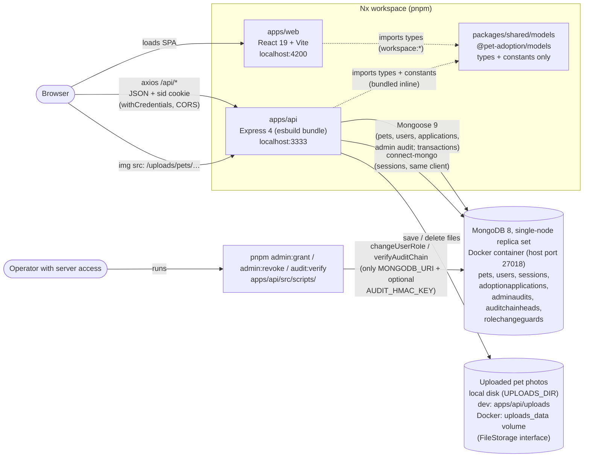

- **Two separate apps.** The frontend calls the API directly at `VITE_API_URL` (read at build time); there is no Vite or nginx proxy. Section 6 shows how they run in Docker and in E2E tests. Ports 4200 and 3333 are different *origins* but the same *site*, so the API enables CORS with `credentials: true` and the `SameSite=Lax` session cookie still flows.
- **The shared library has no runtime dependencies.** It holds the API contract (`Pet`, `User`, `ApiErrorResponse`, input types, allowed values, length limits). Each app keeps its own zod schemas; the API's are checked against the shared types with `satisfies`.
- **One database connection.** The session store reuses Mongoose's MongoDB client instead of opening a second one (`auth/session.ts`).
- **Admins are created outside the API.** `pnpm admin:grant <email>` connects to the database directly and uses the same `changeUserRole` service as the admin area (§3c, §5b). No HTTP route can create the first admin. The command-line tools load only `config/env-file.ts` (`MONGODB_URI`, optional `AUDIT_HMAC_KEY`), not the web server's `config/env.ts`, so they don't need `SESSION_SECRET` or `CORS_ORIGIN`.
- **Photos are files, not database data.** A pet stores up to 5 storage keys in `images`; the API returns `images: [{ _id, url }]` and `imageUrl` (the first photo) built by the storage.
  - **Storage:** `storage/` defines a small `FileStorage` interface (`save`, `delete`, `publicUrl`) with a local-disk implementation, served at `/uploads` with `nosniff` and long-term caching. Object storage (S3, R2) would be a second implementation; nothing else changes.
  - **Upload:** `POST /api/pets/:id/images` checks sign-in, ownership and free photo slots first, then parses multipart with `multer` (in memory, at most 5 files of 5 MB in the field "images"). It detects JPEG, PNG or WebP from each file's bytes and stores the files under random names: all of them or none.
  - **The 5-photo limit is part of the update query** (`$expr` on the array size), so simultaneous uploads can't exceed it.
  - **New files are written first;** files are deleted only after the database no longer points to them. A failed database write removes the new files. Keys are never reused, so a file belongs to exactly one photo.
  - **Deleting:** `DELETE /api/pets/:id/images/:imageId` removes one photo. Deleting the pet removes all its photos too, after the transaction.
  - **Kept for existing clients:** `PUT /api/pets/:id/image` replaces all photos with one; `DELETE /api/pets/:id/image` removes all.
  - **Old records:** pets saved with a single `imageKey` are converted at startup (`backfillPetImages`).
- **A replica set is required.** Adoption decisions use transactions, which a standalone MongoDB rejects, so `connectDatabase` refuses to start without one.
  - **Development:** `docker-compose.yml` runs a single-node replica set.
  - **Tests:** an in-memory replica set (`mongodb-memory-server`, `test/global-setup.ts`).

## 2. Request lifecycle

Example: saving the edit form (`PUT /api/pets/:id`). The other pages follow the same path, using `useQuery` for reads.

### 2a. Frontend

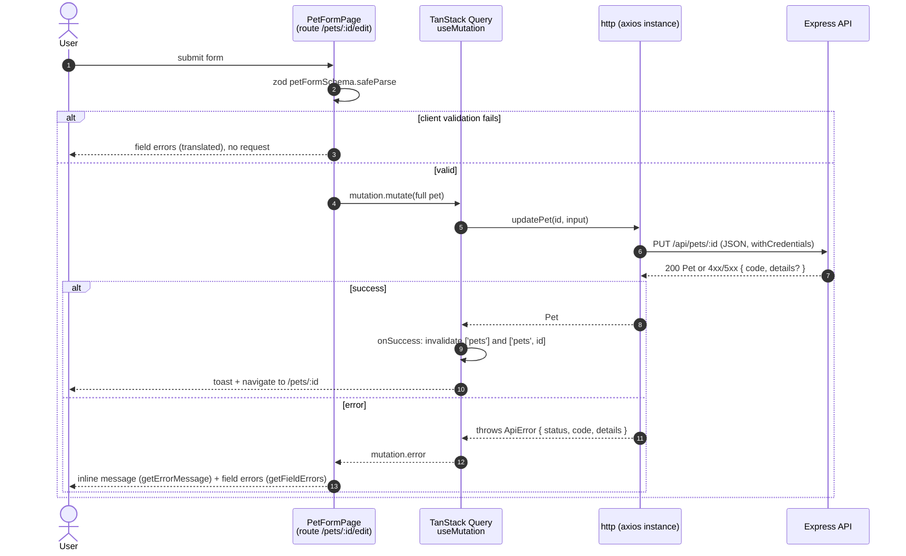

- **React Router only picks the page component.** There are no route loaders or actions; data is fetched inside components with TanStack Query.
  - **Keys:** `petQueryKeys.list(query)` = `['pets', 'list', { search, species, status, sort, page, pageSize }]`, `petQueryKeys.detail(id)`, `applicationQueryKeys.mine(query)` / `.received(query)` = `['applications', 'mine' | 'received', { page, … }]` and `['auth', 'me']`. Invalidating `['pets']` refreshes every list and detail.
  - **The pet list keeps its state in the URL** (`?search=&species=&status=&sort=&page=`) through `useSearchParams`, so Back and shared links restore it. Search is debounced by 300 ms, and any change other than the page resets to page 1.
- **Errors are handled in three places:**
  - The Axios response interceptor (`lib/api-client.ts`) turns every failure into an `ApiError`, including network errors (`NETWORK_ERROR`, status 0).
  - The query client (`app/query-client.ts`) applies the cross-cutting rules: no retries on 4xx, a toast for mutation errors and background-refetch errors, and the user reset to `null` on `UNAUTHENTICATED`.
  - Pages show inline and field errors; the form above opts out of the toast with `meta.skipGlobalErrorToast`.
- **The UI hides what the API would refuse; the API stays authoritative.**
  - `isPetOwner(pet, currentUser)` decides whether Edit and Delete are shown.
  - The form redirects signed-out users to `/login` with `state.from`, and login sends them back. This also happens when a save returns 401, because the global handler clears the current user.

### 2b. API middleware pipeline

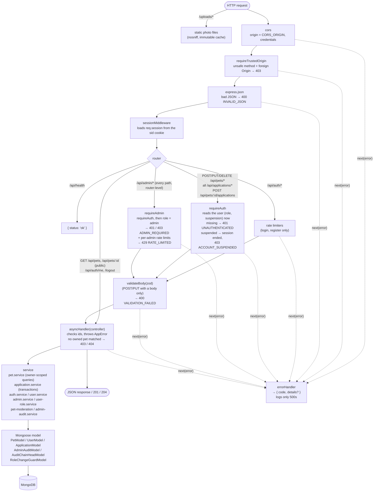

- **Controllers stay thin.** They read params and session, call a service, and map "not found" to `NotFoundError`. Services hold the database access.
- **Errors leave through one place.** Every error, including rate-limit, validation and origin errors, reaches `errorHandler`. Response bodies are always `{ code, details? }`; the web translates `code`.
- **Not every route has every step.**
  - Body validation runs only on routes with a JSON body (`POST /pets`, `PUT /pets/:id`, `POST /pets/:petId/applications`, `POST /auth/register`, `POST /auth/login`, `PUT /admin/users/:id/role`).
  - `requireAuth` runs on pet create, update, delete and photo routes and on every application route, *before* validation, so anonymous requests get 401 whatever the body.
  - `requireAdmin` is mounted on the whole `/api/admin` router (`router.use`), so it also runs for admin paths that match no route: access is denied by default. The admin rate limits run right after it (§5b).
  - Rate limiting runs on `register`/`login` (per IP and per IP+email) and on every admin request (per admin account).
  - Photo uploads (`POST /pets/:id/images`, `PUT /pets/:id/image`) check ownership (and free slots) before `multer` reads the multipart body.
- **Ownership is enforced in the query itself:** `findOneAndUpdate` / `findOneAndDelete` with `{ _id, owner: userId }`. When nothing matches, a second `exists` check decides between 403 `NOT_PET_OWNER` and 404 `PET_NOT_FOUND`. Pets are public, so this reveals nothing private.
- **`GET /api/pets` is paginated.** The query string is validated by `petListQuerySchema` (through `parseInput`), giving the same `VALIDATION_FAILED` errors as bodies.
  - **Parameters:** a name search (case-insensitive and escaped), `species` and `status` filters, a whitelisted `sort`, `page` (at most 10,000) and `pageSize` (default 12, at most 50).
  - **How the query runs:** filters apply before `skip`/`limit`, and `countDocuments` uses the same filter.
  - **Response:** `{ items, page, pageSize, totalItems, totalPages }`.
- **The application lists are paginated the same way** (`page`, `pageSize` default 10, at most 50; newest first with `_id` as tie-breaker). `/applications/mine` is scoped to the session user as applicant; `/applications/received` to the session user as `petOwner`. `/mine` also takes `pet=<id>`, which the pet page uses to fetch only that pet's newest application.

## 3. Authentication flow

Email and password with **server-side sessions**. The browser only holds an opaque, HttpOnly `sid` cookie; the session data lives in MongoDB.

### 3a. Register / login

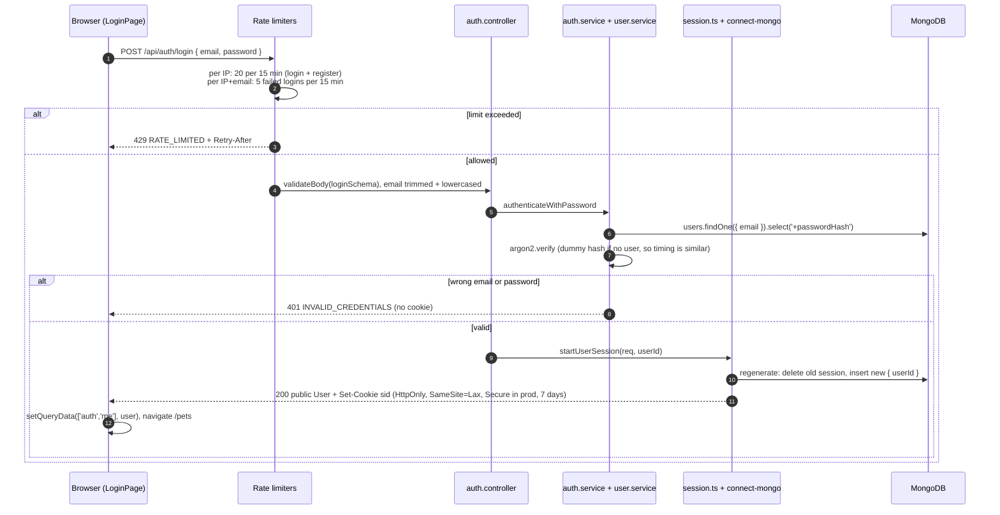

Registration (`POST /api/auth/register`) follows the same path with only the per-IP limiter. It runs `registerWithPassword`, which hashes with Argon2id and calls `createUser`. A duplicate email is caught by the unique index and returns 409 `EMAIL_ALREADY_REGISTERED`. On success it calls the same `startUserSession`, so registering signs the user in.

### 3b. Who am I? / logout

```mermaid
sequenceDiagram
  autonumber
  participant UI as Web (useCurrentUser / UserMenu)
  participant MW as sessionMiddleware
  participant C as auth.controller
  participant DB as MongoDB

  UI->>MW: GET /api/auth/me (cookie sid)
  MW->>DB: sessions.findOne(sid)
  MW->>C: req.session.userId (or none)
  alt no session
    C-->>UI: 401 UNAUTHENTICATED → getCurrentUser returns null
  else session found
    C->>DB: users.findById(userId)
    alt user deleted
      C->>DB: destroy session
      C-->>UI: 401 UNAUTHENTICATED (cookie cleared)
    else user exists
      C-->>UI: 200 public User incl. role (toPublicUser: no passwordHash; missing role → user)
    end
  end

  UI->>C: POST /api/auth/logout
  C->>DB: endUserSession: delete session document
  C-->>UI: 204 + cleared sid cookie
  UI->>UI: setQueryData(['auth','me'], null)
```

- **Session fixation:** `startUserSession` always regenerates the session id. Tests confirm the pre-login cookie stops working.
- **CSRF:** `SameSite=Lax` plus `requireTrustedOrigin`, with no CSRF tokens. Requests without an `Origin` header (non-browser clients) are allowed.
- **Authentication vs authorization.**
  - `requireAuth` (`auth/require-auth.ts`) only answers "who is signed in?". It also rejects sessions whose user was deleted.
  - Ownership ("may this user change this pet?") lives in the pet service queries.
  - The admin role is checked by `requireAdmin` (§3c). Browsing pets stays public.
- **Separate from the sign-in method:** `startUserSession` and `endUserSession` take only a user id. A future OAuth/OIDC callback would find or create a user and call the same function.

### 3c. Roles and authorization

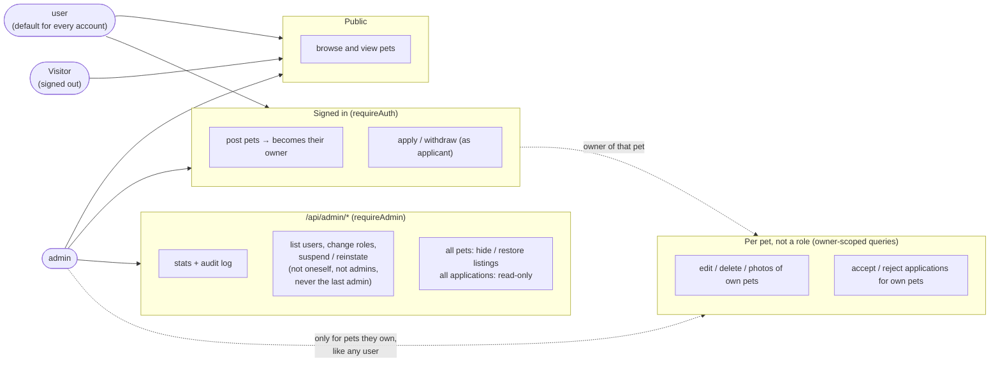

- **Two roles:** `user` and `admin` (`USER_ROLES` in the shared library). There is no "shelter" role: anyone signed in can post pets, and owning a pet is a relation to that pet (`pet.owner`), not a role. Admins get no shortcut around ownership or the adoption state machine; on someone else's pet they get the same 403/404 as any user.
- **Where the role comes from:** the `role` field on the user document (default `user`; missing on older users, which counts as `user`). The session stores only `userId`. `requireAuth` reads the user's `role` and `suspendedAt` from MongoDB on **every** request (one query; `requireAdmin` reuses it), so promotion, demotion and suspension take effect on the user's next request without signing in again, and nothing the client sends (body, URL, headers, the cached `/auth/me`) can grant access.
- **Suspended accounts:** `requireAuth` ends the session and answers 403 `ACCOUNT_SUSPENDED`; `/auth/me` ends it and answers 401 (the web shows the user as signed out); sign-in answers 403 `ACCOUNT_SUSPENDED` only after a correct password. Browsing stays public. Admins can't be suspended, so an active admin always remains.
- **Who can change a role or suspension:** only `changeUserRole`, `suspendUser` and `reinstateUser` (`admin/user-role.service.ts`), called by the admin endpoints (acting admin from the session) and, for roles, by the `admin:grant` / `admin:revoke` command (no actor; an operator with database access). Registration ignores any `role` field: `registerSchema` strips unknown keys and `createUser` writes only email, name and password hash.
- **The web** shows the Admin link and the `/admin` pages only when `/auth/me` says `role: 'admin'` (usability only). An `ADMIN_REQUIRED` response refetches `/auth/me`, so a demoted admin's UI updates; `ACCOUNT_SUSPENDED` signs the user out in the web; all admin query data is removed on every identity change (`setCurrentUser`).

## 4. Data model

### Implemented

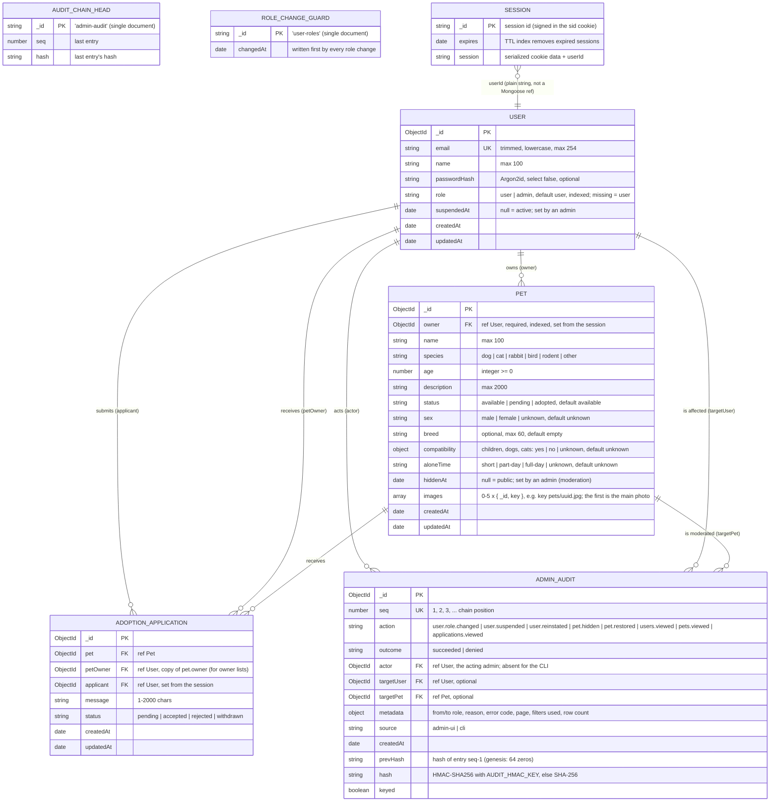

- **Mongoose models:** `USER`, `PET`, `ADOPTION_APPLICATION`, `ADMIN_AUDIT`, `AUDIT_CHAIN_HEAD` and `ROLE_CHANGE_GUARD` (`users/`, `pets/`, `applications/`, `admin/`). `SESSION` is the `sessions` collection, managed by `connect-mongo`; it has no Mongoose model.
- **Admin audit log:** written in the same transaction as each change, so a change never exists without its record; refused attempts and list views get their own entry. No update or delete path exists in the app (model hooks refuse them). See §5b for the hash chain and its limits.
- **Hidden pets** (`hiddenAt` set) are left out of `GET /api/pets` and return 404 from `GET /api/pets/:id` except to their owner and admins. The API returns only a `hidden` flag, never who hid it.
- **`owner` and `applicant` come only from the session.** Pets expose the owner as an id only. Applicant name and email are returned only to the owner of the pet.
- **Pet profile facts** (`sex`, `breed`, `compatibility`, `aloneTime`) are optional in the API input. Pets stored before they existed lack them; `withProfileDefaults` fills `unknown`/empty in every response, so no migration is needed.
- **Pets created before ownership** have no `owner`. They stay visible, but nobody can edit, delete or apply for them until they are backfilled or removed (see progress.md).
- **Statuses are server-managed** and stripped from request bodies; they change only through the state machines below.
- **Pet list index:** `{ createdAt: -1, _id: -1 }` serves the default "newest" order (and "oldest", read backwards) without an in-memory sort. Name search (a case-insensitive "contains" match) and species/status filters are not indexed: a contains-regex can't use an index efficiently, and the filters have only three values each.
- **`petOwner` is a copy of the pet's owner,** set when the application is submitted, so `GET /applications/received` can filter, sort and page one collection instead of first loading all of the owner's pet ids. Pets never change owner, so the copy can't go stale. Applications created before the field existed are filled in at API startup (`backfillApplicationPetOwners`).
- **Application list indexes:** `{ applicant, createdAt: -1, _id: -1 }` and `{ petOwner, createdAt: -1, _id: -1 }` match the newest-first order of the two paginated lists.
- **Unique partial indexes on applications:**
  - `{ pet, applicant }` for statuses `pending`, `accepted` and `rejected`: one application per user and pet; a withdrawn one can be replaced.
  - `{ pet }` where `status: 'accepted'`: at most one accepted application per pet.

## 5. Adoption workflow

The state machines live in the shared library (`adoption-application.model.ts`), so the API enforces them and the web uses them to decide which buttons to show. Statuses change only through explicit actions; nothing sets a status directly.

### Application states

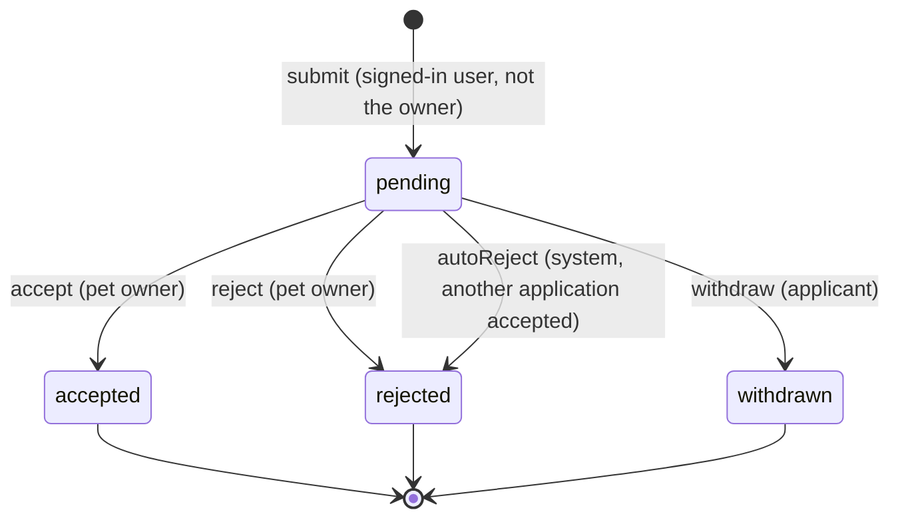

### Pet states

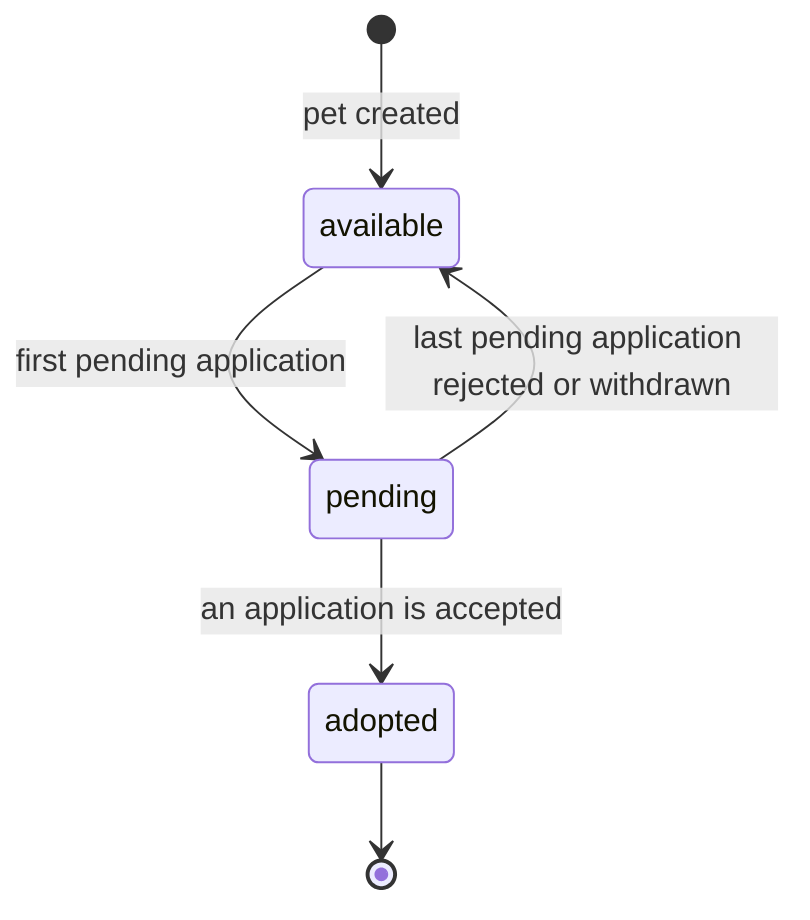

- **How the two machines interact:** the pet status always follows from its applications. `application.service.ts` applies the pet transition in the same transaction as the application change, and `transitionPetStatus` rejects any change the pet machine doesn't allow.
- **When a transition fails:**
  - Wrong actor → 403 (`NOT_PET_OWNER` / `NOT_APPLICANT`).
  - Someone who is neither applicant nor owner → 404 `APPLICATION_NOT_FOUND`, because applications are private.
  - A final state → 409 `INVALID_STATUS_TRANSITION`.
  - An adopted pet → 409 `PET_NOT_AVAILABLE`.
- **Deleting a pet** is blocked by pending or accepted applications (409 `PET_HAS_ACTIVE_APPLICATIONS`). Otherwise its rejected and withdrawn applications are deleted with it, in one transaction.

### Accepting an application (one transaction)

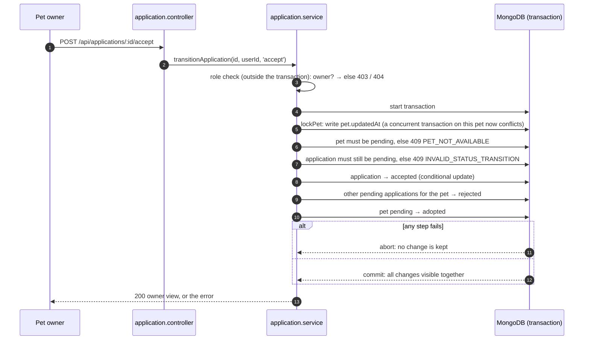

- **Concurrency:** the first write locks the pet, so two simultaneous acceptances (or a withdraw racing a reject) can't both act on stale data. MongoDB raises a write conflict, `connection.transaction()` retries the losing transaction, and the retry sees the committed result (409). The unique "one accepted per pet" index is the final guarantee.
- **The same pattern** (lock the pet, check, write, adjust the pet status) is used for submit, reject and withdraw, so the pet status stays consistent even when the last two pending applications end at the same moment.

### 5b. Administration

Admins see platform-wide counts, users, pets, applications and the audit log; they change roles, suspend and reinstate users, and hide and restore listings. Applications stay **read-only**: adoption decisions stay with owners and applicants (§5), so admins can't create a second accepted application or skip the pet lock. The application list leaves out the applicant's message.

| Endpoint (all behind `requireAdmin` + rate limits) | Purpose |
|---|---|
| `GET /api/admin/stats` | Users (total, admins, suspended), pets by status and hidden, applications by status, the 5 newest audited *changes* |
| `GET /api/admin/audit?action=&page=&pageSize=` | The audit log, newest first (not itself audited) |
| `GET /api/admin/users?search=&role=&status=&page=&pageSize=` | Users with role, suspension, pet and application counts; search matches name or email (escaped, any case); page size 20 (max 50). **Audited** (`users.viewed`) |
| `PUT /api/admin/users/:id/role` `{ role }` | Change a role |
| `POST /api/admin/users/:id/suspend` `{ reason? }` / `…/reinstate` | Suspend / lift a suspension |
| `GET /api/admin/pets?…&visibility=` | The pet list (public parameters, hidden pets included) with owners and `hiddenAt`. **Audited** (`pets.viewed`) |
| `POST /api/admin/pets/:id/hide` `{ reason? }` / `…/restore` | Hide / restore a listing |
| `GET /api/admin/applications?status=&page=&pageSize=` | All applications with pet, applicant and owner (no message). **Audited** (`applications.viewed`) |

**Rules** (in `user-role.service.ts` and `pet-moderation.service.ts`):
- Nobody changes their own role or suspends themselves.
- The last admin keeps the role.
- Admins can't be suspended; suspended users can't be made admins.
- Suspension keeps all data. A suspended applicant's pending applications stay pending: the owner can reject them, but accepting returns 409 `APPLICANT_SUSPENDED`.
- Hiding keeps the pet, its status and its applications; only new applications are refused (404, checked after the pet lock). The owner keeps seeing and managing it and can't unhide it (`hiddenAt` is in no input schema).

```mermaid
sequenceDiagram
  autonumber
  actor Op as Operator (server access)
  actor A as Admin (browser)
  participant CLI as pnpm admin:grant
  participant API as /api/admin/... (change)
  participant S as runAudited + service
  participant DB as MongoDB (transaction)

  Note over Op,CLI: First admin: the person registers in the app, then
  Op->>CLI: admin:grant <email> (dry run), then --yes
  CLI->>S: changeUserRole { target, role: admin, source: cli } (no actor)

  Note over A,API: Later: Users / Pets pages (inline confirmation, optional reason)
  A->>API: role / suspend / reinstate / hide / restore + sid cookie
  API->>API: requireAdmin (role + suspension read now) → rate limit (30 changes / 15 min / admin) → validateBody
  API->>S: { target from URL, actor from session, source: admin-ui }
  S->>DB: user changes: write the role-change guard first; listings: lock the pet first
  S->>DB: actor still an active admin? else 403 ADMIN_REQUIRED
  S->>DB: rules (own account, last admin, admin/suspended, target exists)
  S->>DB: apply the change + append the audit entry (same transaction)
  DB-->>S: commit, or abort: nothing kept
  alt a rule refused it (AppError)
    S->>DB: append an audit entry with outcome denied + the error code
    S-->>API: 403 / 404 / 409 { code }
  else
    S-->>API: 200 (public user or pet)
  end
```

- **Why the guard document:** each transaction alone would see another admin, so two admins demoting each other at the same moment could otherwise leave none; likewise a promotion and a suspension of the same user could otherwise both succeed. Every role or suspension change writes the same document first; MongoDB lets one transaction hold it, the other retries and then sees the result (both tested).
- **Effect on sessions:** nothing to revoke. The next request of the affected user is authorized against the current role and suspension (tested: a demoted admin gets 403, a suspended user's open session gets 403 `ACCOUNT_SUSPENDED` and is ended).
- **Rate limits** (`middleware/rate-limit.ts`): per admin account, keyed by the user id from the session (spoofed `X-Forwarded-For` headers don't matter): 300 reads and 30 changes per 15 minutes, 429 `RATE_LIMITED`. Counters are in process memory, like the sign-in limits: they reset on restart and are not shared between several API instances.

**The audit chain** (`admin-audit.service.ts`):
- **Appending:** every entry gets the next `seq`, the previous entry's hash as `prevHash`, and `hash` = HMAC-SHA256 (with `AUDIT_HMAC_KEY`) or SHA-256 (without a key) over its content. The single `AUDIT_CHAIN_HEAD` document is updated in the same transaction, which serializes concurrent appends.
- **Checking:** `pnpm audit:verify` (or `verifyAuditChain`) walks the chain and reports gaps, broken links, changed content and a head that doesn't match the last entry.
- **Trust boundary: tamper-evident, not tamper-proof.** The application can't change or delete entries, but anyone with database write access can.
  - Without the key, they can also rewrite the chain consistently.
  - With the key (kept outside the database), they can't forge entries, but they can still delete the newest entries and roll back the head.
  - Detecting that needs a copy of the head outside the database (planned with hosting; see production-readiness.md A3).

## 6. Runtime environments

### Docker Compose

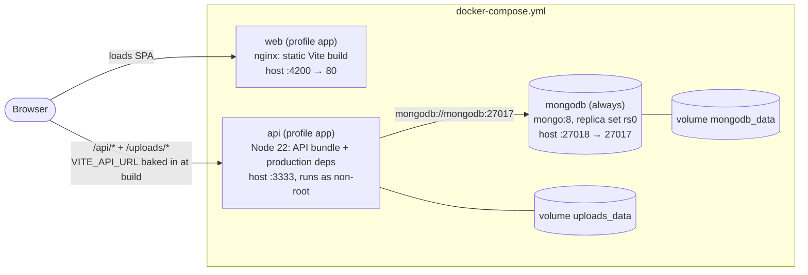

- **Two modes.** `docker compose up -d` starts only `mongodb`, for running the apps with Nx. `docker compose --profile app up -d --build` also builds and starts `api` and `web`.
- **Start order:** `api` waits until `mongodb` is healthy (the health check also initiates the replica set on first start); `web` waits until `api` answers `/api/health`.
- **Images:** the API image is built from the Nx `prune` output (bundle plus a pruned lockfile). The web image serves the Vite build with nginx, which sends every client-side route to `index.html`.
- **Browser-facing addresses:** the browser calls the API at `localhost`, not through the Compose network, so `VITE_API_URL`, `CORS_ORIGIN` and `UPLOADS_BASE_URL` use host ports (`API_PORT`, `WEB_PORT` in the root `.env`).
- **Plain HTTP:** the API runs with `NODE_ENV=development` in Compose, so session cookies are not marked `Secure`.

### Docker QA stack

`docker-compose.qa.yml` (project `pet-adoption-qa`) runs the same Dockerfiles for manual QA. It shares nothing with the main stack above: different containers, network and volumes.

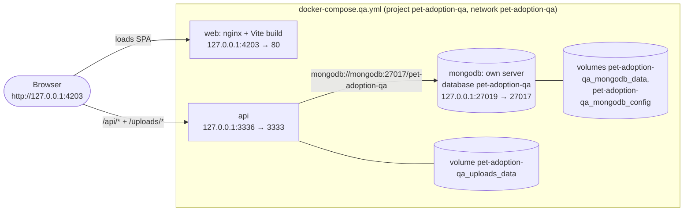

- **Isolation by storage:** a separate MongoDB server and separate volumes, not just a different database name.
  - **Fixed connection:** the API's connection string is fixed in the QA file.
  - **Host names blocked:** `host.docker.internal` and `gateway.docker.internal` resolve to the container itself.
  - **Still reachable by raw IP:** the development MongoDB's published port 27018 can still be reached at the Docker host's IP addresses. Nothing in the QA configuration uses them.
- **Bound to `127.0.0.1`:** all three ports. The API's CORS origin is `http://127.0.0.1:4203`, so the QA session cookie (on `127.0.0.1`) never collides with the other environments' cookies on `localhost`.
- **Scripts:** `pnpm qa:up|ps|logs|down` always pass the QA file and project and refuse options such as `-v`.
  - **`pnpm qa:seed`** seeds exactly `http://127.0.0.1:3336/api`.
  - **`pnpm qa:reset`** checks the containers' project, volumes and database before emptying the QA data; it never deletes volumes. See `apps/api/src/scripts/qa-config.ts`.

### E2E tests

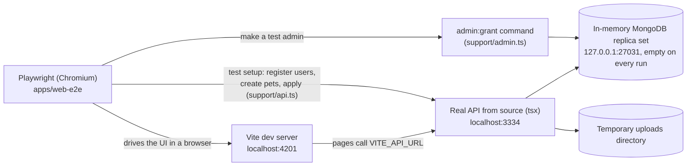

- **Admins in E2E** are created exactly like in production: the test registers a user through the API, then runs the real `admin:grant` command against the run's database (fixed port 27031, `E2E_MONGODB_URI` in `support/config.ts`). There is no test-only way to become an admin.

- **Isolated:** Playwright starts both servers itself (`reuseExistingServer: false`), so dev servers, Docker containers and dev data are never used.
- **No seed data:** each test creates uniquely named users and pets through the API, then checks the journeys in the UI.
- **No retries:** login and register share the per-IP rate limit, and retries would add attempts against the same API process.
