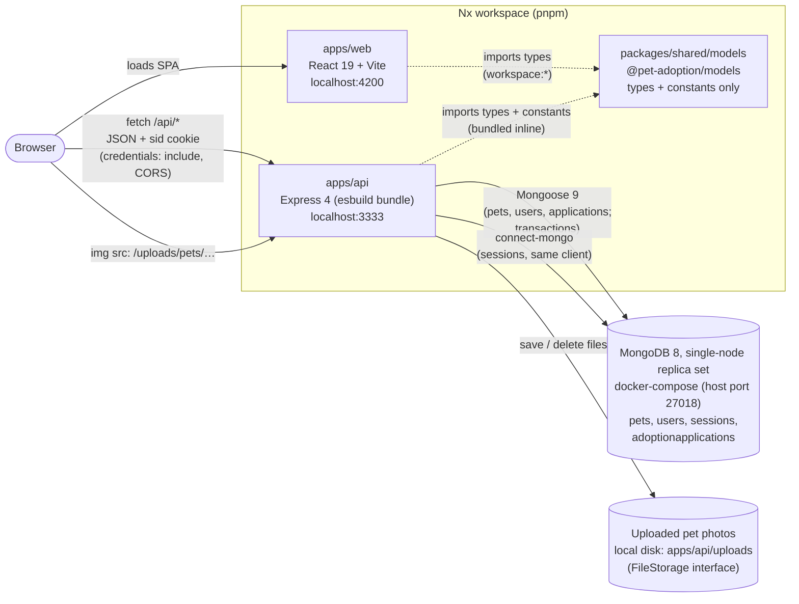
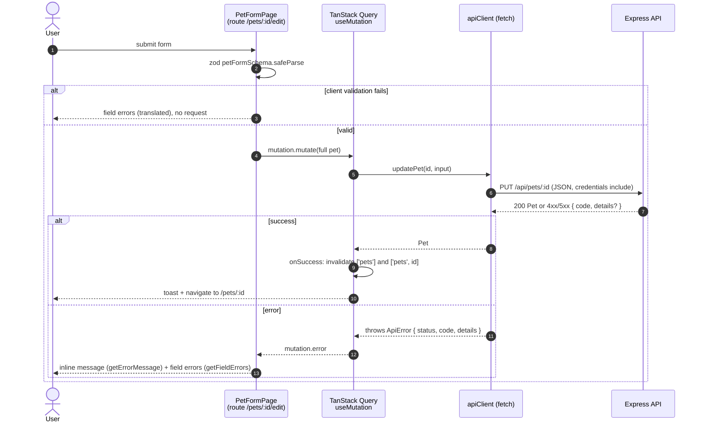
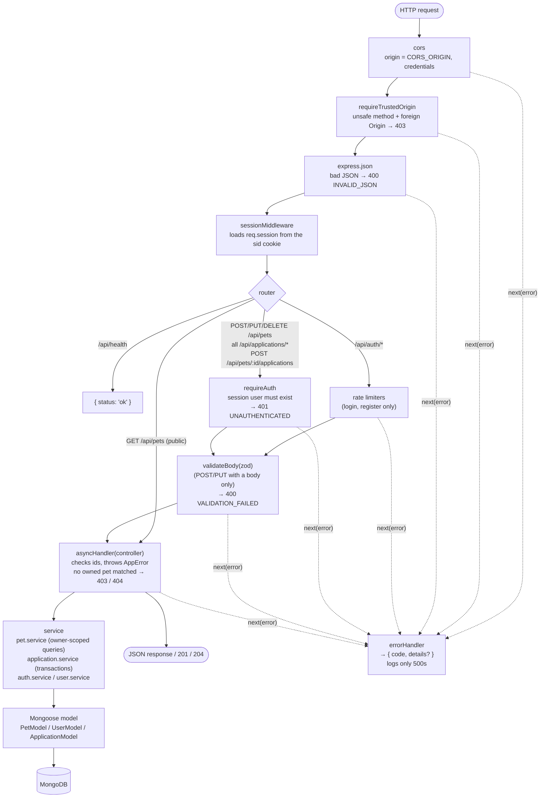
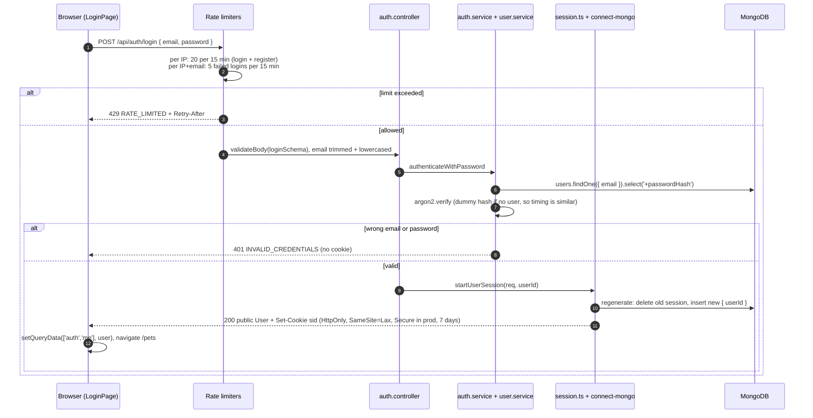
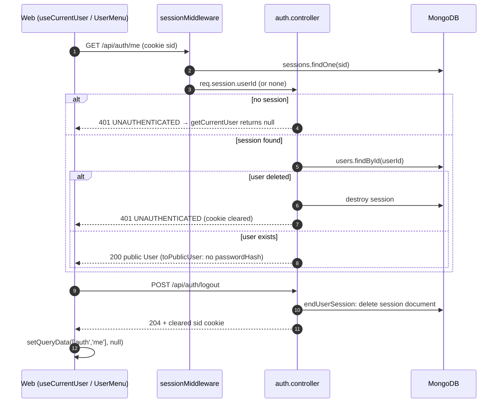
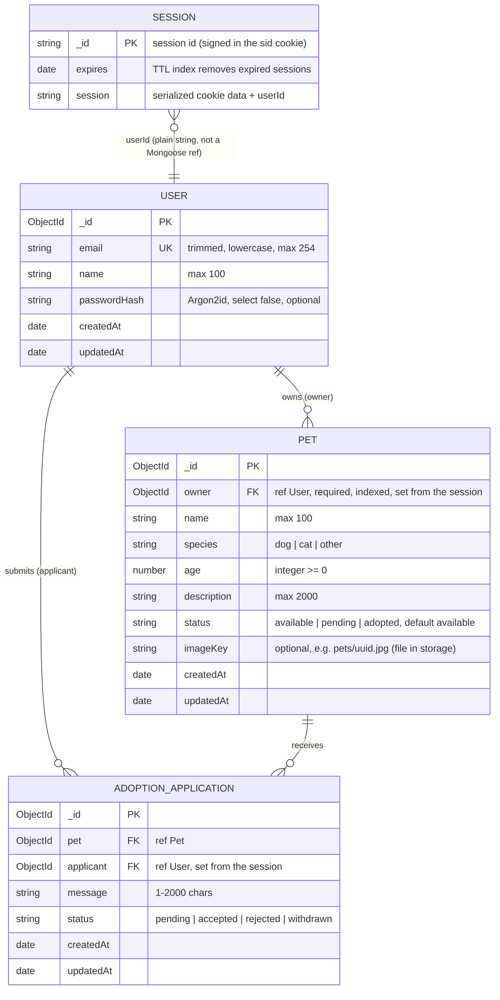
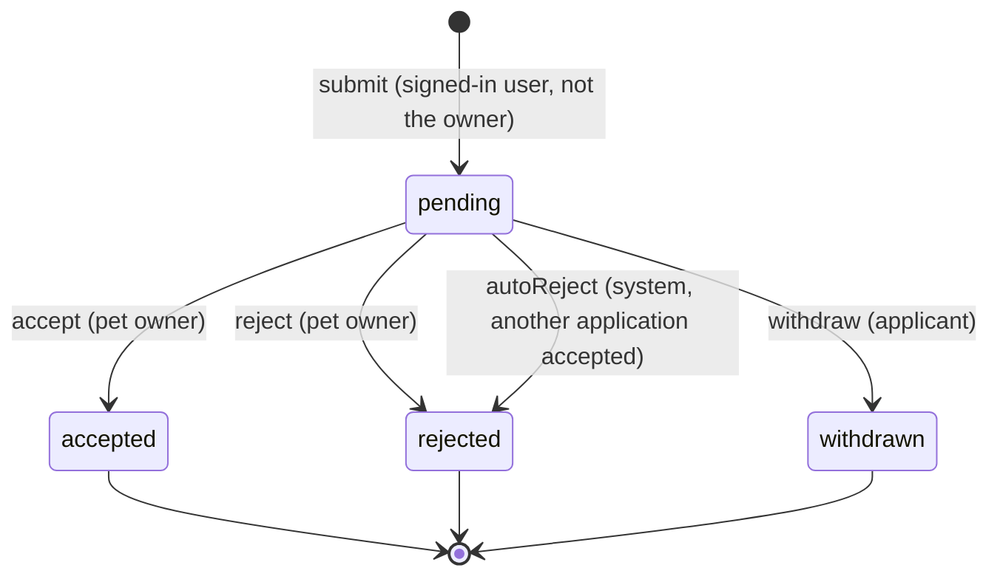
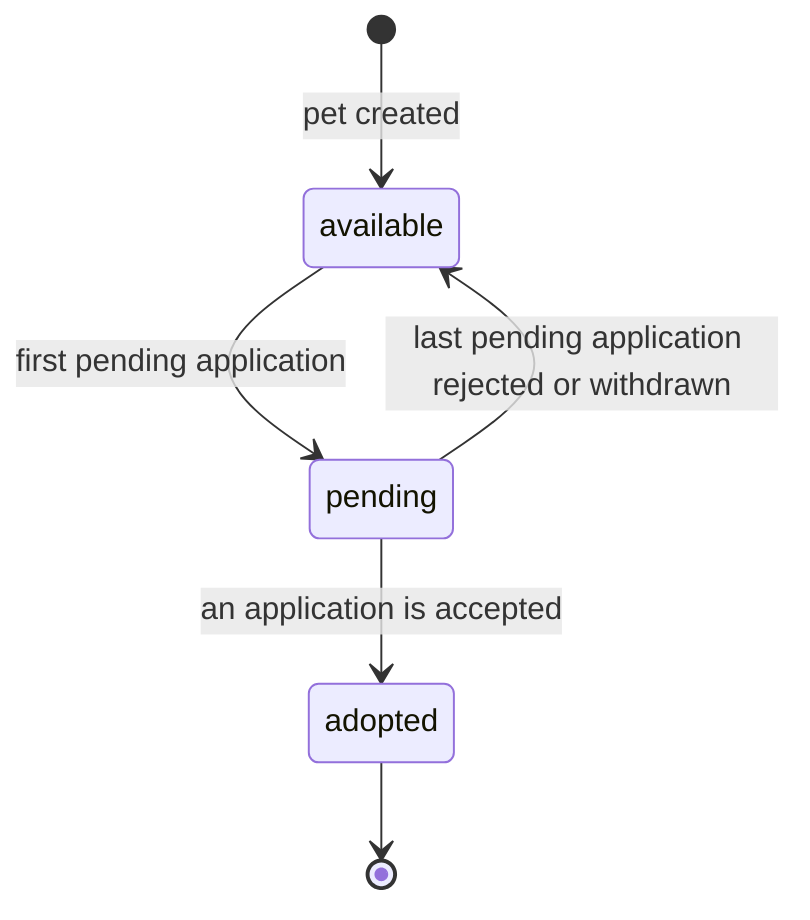
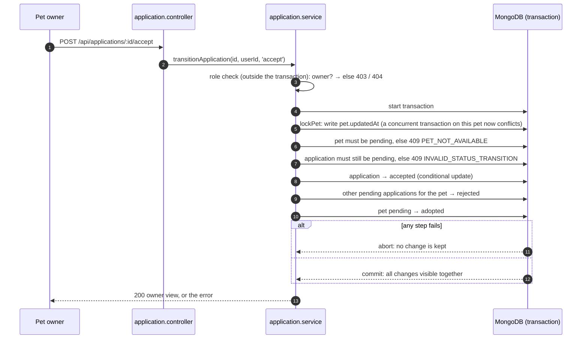

# Architecture

Diagrams of the **current** implementation (verified against the code on 2026-10-20, after the adoption applications step). For status, open issues and the roadmap, see [progress.md](progress.md); for conventions, see [../CLAUDE.md](../CLAUDE.md).

Legend: solid lines and boxes = implemented. Dashed lines or anything labelled _planned_ = not implemented yet.

## 1. System architecture

- **Two separate apps.** The frontend calls the API directly at `VITE_API_URL`; there is no Vite proxy. Ports 4200 and 3333 are different *origins* but the same *site*, so the API enables CORS with `credentials: true` and the `SameSite=Lax` session cookie still flows.
- **The shared library has no runtime dependencies.** It holds the API contract (`Pet`, `User`, `ApiErrorResponse`, input types, allowed values, length limits). Each app keeps its own zod schemas; the API's are checked against the shared types with `satisfies`.
- **One database connection.** The session store reuses Mongoose's MongoDB client instead of opening a second one (`auth/session.ts`).
- **Photos are files, not database data.** A pet stores only an `imageKey`; the API returns `imageUrl` built by the storage.
  - **Storage:** `storage/` defines a small `FileStorage` interface (`save`, `delete`, `publicUrl`) with a local-disk implementation, served at `/uploads` with `nosniff` and long-term caching. Object storage (S3, R2) would be a second implementation; nothing else changes.
  - **Upload:** `PUT /api/pets/:id/image` checks sign-in and ownership first, then parses multipart with `multer` (in memory, 5 MB maximum, one file in the field "image"). It detects JPEG, PNG or WebP from the file's bytes and stores the file under a random name.
  - **Replacing a photo:** the new file is written first; the old one is deleted after the database points to the new one. A failed database write removes the new file.
  - **Deleting:** `DELETE /api/pets/:id/image` removes the photo. Deleting the pet removes its photo too, after the transaction.
- **A replica set is required.** Adoption decisions use transactions, which a standalone MongoDB rejects, so `connectDatabase` refuses to start without one.
  - **Development:** `docker-compose.yml` runs a single-node replica set.
  - **Tests:** an in-memory replica set (`mongodb-memory-server`, `test/global-setup.ts`).

## 2. Request lifecycle

Example: saving the edit form (`PUT /api/pets/:id`). The other pages follow the same path, using `useQuery` for reads.

### 2a. Frontend

- **React Router only picks the page component.** There are no route loaders or actions; data is fetched inside components with TanStack Query.
  - **Keys:** `petQueryKeys.list(query)` = `['pets', 'list', { search, species, status, sort, page, pageSize }]`, `petQueryKeys.detail(id)`, `['applications', …]` and `['auth', 'me']`. Invalidating `['pets']` refreshes every list and detail.
  - **The pet list keeps its state in the URL** (`?search=&species=&status=&sort=&page=`) through `useSearchParams`, so Back and shared links restore it. Search is debounced by 300 ms, and any change other than the page resets to page 1.
- **Errors are handled in three places:**
  - `apiClient` turns every failure into an `ApiError`, including network errors (`NETWORK_ERROR`, status 0).
  - The query client (`app/query-client.ts`) applies the cross-cutting rules: no retries on 4xx, a toast for mutation errors and background-refetch errors, and the user reset to `null` on `UNAUTHENTICATED`.
  - Pages show inline and field errors; the form above opts out of the toast with `meta.skipGlobalErrorToast`.
- **The UI hides what the API would refuse; the API stays authoritative.**
  - `isPetOwner(pet, currentUser)` decides whether Edit and Delete are shown.
  - The form redirects signed-out users to `/login` with `state.from`, and login sends them back. This also happens when a save returns 401, because the global handler clears the current user.

### 2b. API middleware pipeline

- **Controllers stay thin.** They read params and session, call a service, and map "not found" to `NotFoundError`. Services hold the database access.
- **Errors leave through one place.** Every error, including rate-limit, validation and origin errors, reaches `errorHandler`. Response bodies are always `{ code, details? }`; the web translates `code`.
- **Not every route has every step.**
  - Validation runs only on routes with a body (`POST /pets`, `PUT /pets/:id`, `POST /auth/register`, `POST /auth/login`).
  - Rate limiting runs only on `register` and `login`.
  - `requireAuth` runs on pet create, update and delete and on every application route, *before* validation, so anonymous requests get 401 whatever the body.
- **Ownership is enforced in the query itself:** `findOneAndUpdate` / `findOneAndDelete` with `{ _id, owner: userId }`. When nothing matches, a second `exists` check decides between 403 `NOT_PET_OWNER` and 404 `PET_NOT_FOUND`. Pets are public, so this reveals nothing private.
- **`GET /api/pets` is paginated.** The query string is validated by `petListQuerySchema` (through `parseInput`), giving the same `VALIDATION_FAILED` errors as bodies.
  - **Parameters:** a name search (case-insensitive and escaped), `species` and `status` filters, a whitelisted `sort`, `page` (at most 10,000) and `pageSize` (default 12, at most 50).
  - **How the query runs:** filters apply before `skip`/`limit`, and `countDocuments` uses the same filter.
  - **Response:** `{ items, page, pageSize, totalItems, totalPages }`.

## 3. Authentication flow

Email and password with **server-side sessions**. The browser only holds an opaque, HttpOnly `sid` cookie; the session data lives in MongoDB.

### 3a. Register / login

Registration (`POST /api/auth/register`) follows the same path with only the per-IP limiter. It runs `registerWithPassword`, which hashes with Argon2id and calls `createUser`. A duplicate email is caught by the unique index and returns 409 `EMAIL_ALREADY_REGISTERED`. On success it calls the same `startUserSession`, so registering signs the user in.

### 3b. Who am I? / logout

- **Session fixation:** `startUserSession` always regenerates the session id. Tests confirm the pre-login cookie stops working.
- **CSRF:** `SameSite=Lax` plus `requireTrustedOrigin`, with no CSRF tokens. Requests without an `Origin` header (non-browser clients) are allowed.
- **Authentication vs authorization.**
  - `requireAuth` (`auth/require-auth.ts`) only answers "who is signed in?". It also rejects sessions whose user was deleted.
  - Ownership ("may this user change this pet?") lives in the pet service queries.
  - Browsing pets stays public. There are no admin roles.
- **Separate from the sign-in method:** `startUserSession` and `endUserSession` take only a user id. A future OAuth/OIDC callback would find or create a user and call the same function.

## 4. Data model

### Implemented

- **Mongoose models:** `USER`, `PET` and `ADOPTION_APPLICATION` (`users/`, `pets/`, `applications/`). `SESSION` is the `sessions` collection, managed by `connect-mongo`; it has no Mongoose model.
- **`owner` and `applicant` come only from the session.** Pets expose the owner as an id only. Applicant name and email are returned only to the owner of the pet.
- **Pets created before ownership** have no `owner`. They stay visible, but nobody can edit, delete or apply for them until they are backfilled or removed (see progress.md).
- **Statuses are server-managed** and stripped from request bodies; they change only through the state machines below.
- **Pet list index:** `{ createdAt: -1, _id: -1 }` serves the default "newest" order (and "oldest", read backwards) without an in-memory sort. Name search (a case-insensitive "contains" match) and species/status filters are not indexed: a contains-regex can't use an index efficiently, and the filters have only three values each.
- **Unique partial indexes on applications:**
  - `{ pet, applicant }` for statuses `pending`, `accepted` and `rejected`: one application per user and pet; a withdrawn one can be replaced.
  - `{ pet }` where `status: 'accepted'`: at most one accepted application per pet.

## 5. Adoption workflow

The state machines live in the shared library (`adoption-application.model.ts`), so the API enforces them and the web uses them to decide which buttons to show. Statuses change only through explicit actions; nothing sets a status directly.

### Application states

### Pet states

- **How the two machines interact:** the pet status always follows from its applications. `application.service.ts` applies the pet transition in the same transaction as the application change, and `transitionPetStatus` rejects any change the pet machine doesn't allow.
- **When a transition fails:**
  - Wrong actor → 403 (`NOT_PET_OWNER` / `NOT_APPLICANT`).
  - Someone who is neither applicant nor owner → 404 `APPLICATION_NOT_FOUND`, because applications are private.
  - A final state → 409 `INVALID_STATUS_TRANSITION`.
  - An adopted pet → 409 `PET_NOT_AVAILABLE`.
- **Deleting a pet** is blocked by pending or accepted applications (409 `PET_HAS_ACTIVE_APPLICATIONS`). Otherwise its rejected and withdrawn applications are deleted with it, in one transaction.

### Accepting an application (one transaction)

- **Concurrency:** the first write locks the pet, so two simultaneous acceptances (or a withdraw racing a reject) can't both act on stale data. MongoDB raises a write conflict, `connection.transaction()` retries the losing transaction, and the retry sees the committed result (409). The unique "one accepted per pet" index is the final guarantee.
- **The same pattern** (lock the pet, check, write, adjust the pet status) is used for submit, reject and withdraw, so the pet status stays consistent even when the last two pending applications end at the same moment.
