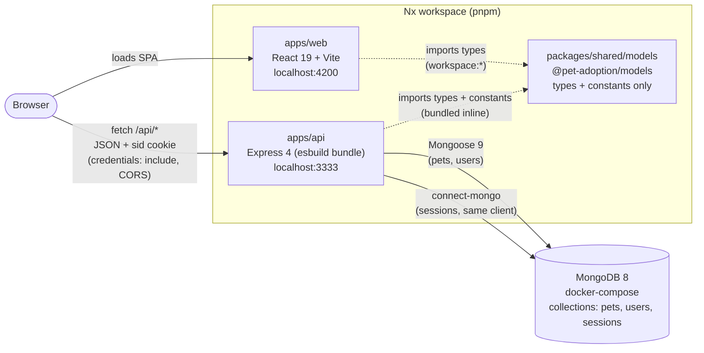
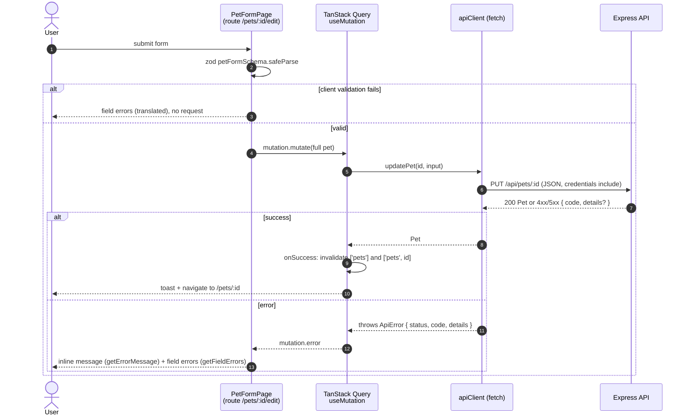
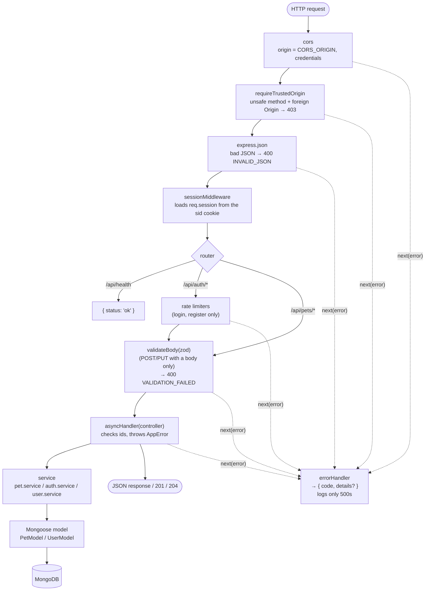
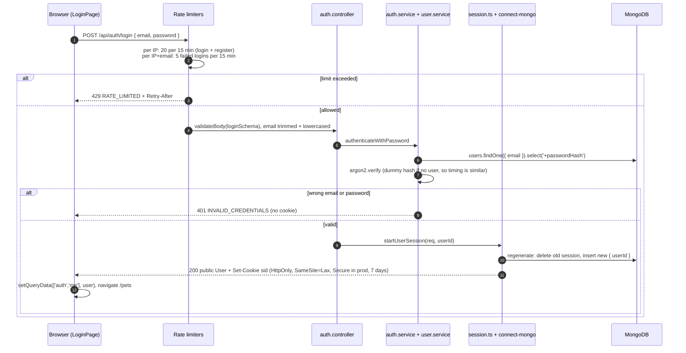
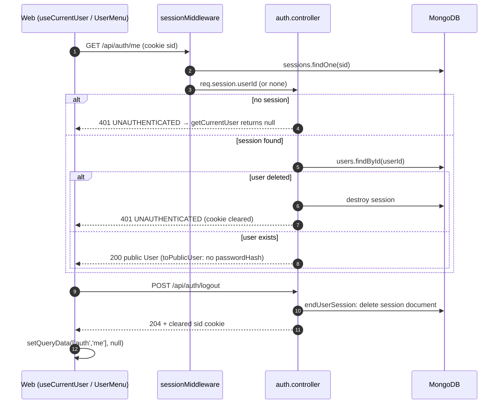
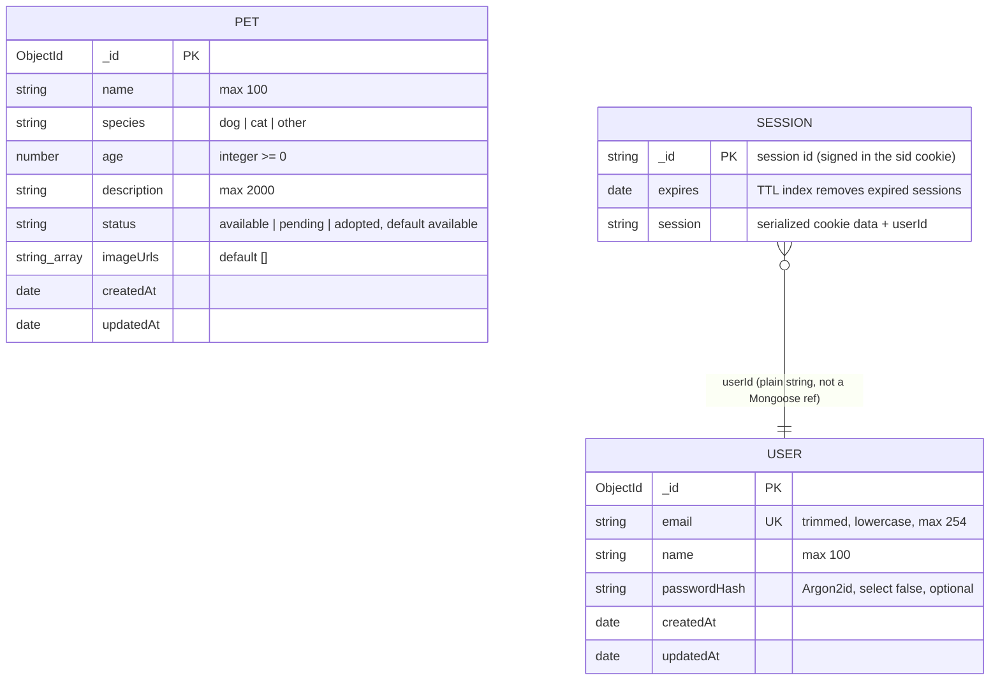
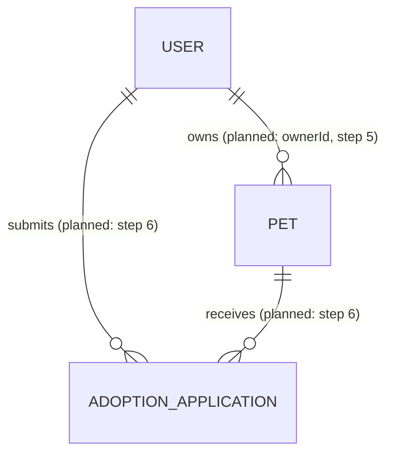

# Architecture

Diagrams of the **current** implementation (verified against the code on 2026-10-19, commit `b06a917`). For status, open issues and the roadmap, see [progress.md](progress.md); for conventions, see [../CLAUDE.md](../CLAUDE.md).

Legend: solid lines and boxes = implemented. Dashed lines or anything labelled _planned_ = not implemented yet.

## 1. System architecture

- **Two separate apps.** The frontend calls the API directly at `VITE_API_URL`; there is no Vite proxy. Ports 4200 and 3333 are different *origins* but the same *site*, so the API enables CORS with `credentials: true` and the `SameSite=Lax` session cookie still flows.
- **The shared library has no runtime dependencies.** It holds the API contract (`Pet`, `User`, `ApiErrorResponse`, input types, allowed values, length limits). Each app keeps its own zod schemas; the API's are checked against the shared types with `satisfies`.
- **One database connection.** The session store reuses Mongoose's MongoDB client instead of opening a second one (`auth/session.ts`).

## 2. Request lifecycle

Example: saving the edit form (`PUT /api/pets/:id`). The other pages follow the same path, using `useQuery` for reads.

### 2a. Frontend

- **React Router only picks the page component.** There are no route loaders or actions; data is fetched inside components with TanStack Query (`['pets']`, `['pets', id]`, `['auth', 'me']`).
- **Errors are handled in three places:**
  - `apiClient` turns every failure into an `ApiError`, including network errors (`NETWORK_ERROR`, status 0).
  - The query client (`app/query-client.ts`) applies the cross-cutting rules: no retries on 4xx, a toast for mutation errors and background-refetch errors, and the user reset to `null` on `UNAUTHENTICATED`.
  - Pages show inline and field errors; the form above opts out of the toast with `meta.skipGlobalErrorToast`.

### 2b. API middleware pipeline

- **Controllers stay thin.** They read params and session, call a service, and map "not found" to `NotFoundError`. Services hold the database access.
- **Errors leave through one place.** Every error, including rate-limit, validation and origin errors, reaches `errorHandler`. Response bodies are always `{ code, details? }`; the web translates `code`.
- **Not every route has every step.** Validation runs only on routes with a body (`POST /pets`, `PUT /pets/:id`, `POST /auth/register`, `POST /auth/login`). Rate limiting runs only on `register` and `login`.

## 3. Authentication flow

Email and password with **server-side sessions**. The browser only holds an opaque, HttpOnly `sid` cookie; the session data lives in MongoDB.

### 3a. Register / login

Registration (`POST /api/auth/register`) follows the same path with only the per-IP limiter. It runs `registerWithPassword`, which hashes with Argon2id and calls `createUser`. A duplicate email is caught by the unique index and returns 409 `EMAIL_ALREADY_REGISTERED`. On success it calls the same `startUserSession`, so registering signs the user in.

### 3b. Who am I? / logout

- **Session fixation:** `startUserSession` always regenerates the session id. Tests confirm the pre-login cookie stops working.
- **CSRF:** `SameSite=Lax` plus `requireTrustedOrigin`, with no CSRF tokens. Requests without an `Origin` header (non-browser clients) are allowed.
- **Authentication only.** No route requires a session except `/me`. Pet create, edit and delete are currently open to everyone (planned: step 5, ownership).
- **Separate from the sign-in method:** `startUserSession` and `endUserSession` take only a user id. A future OAuth/OIDC callback would find or create a user and call the same function.

## 4. Data model

### Implemented

- **`USER` and `PET` are Mongoose models** (`users/user.model.ts`, `pets/pet.model.ts`). `SESSION` is the `sessions` collection, managed by `connect-mongo`; it has no Mongoose model.
- **Pets and users are not linked yet.** No pet stores who posted it.
- **`status` can't change through the API yet.** It is server-managed and stripped from request bodies, so every pet stays `available` for now.

### Planned (not implemented)

The field names and statuses for applications are not decided yet; see the roadmap in [progress.md](progress.md).
